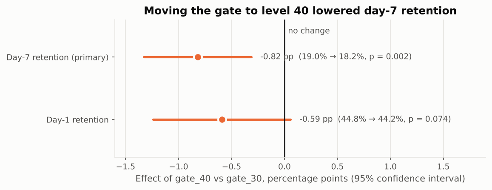
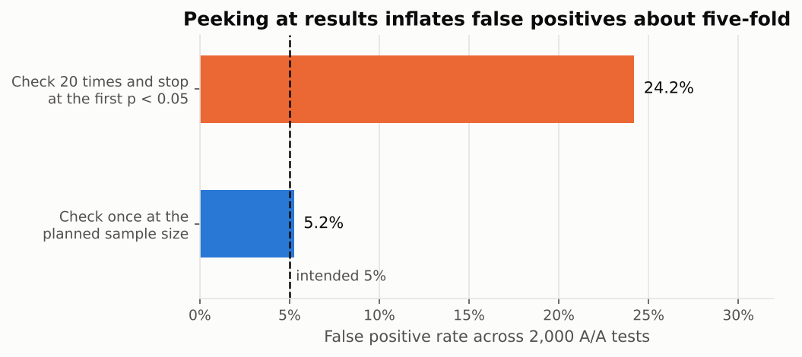
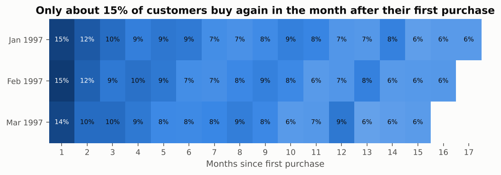
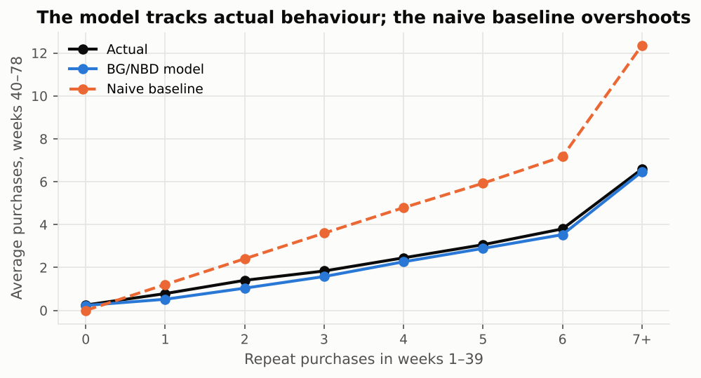
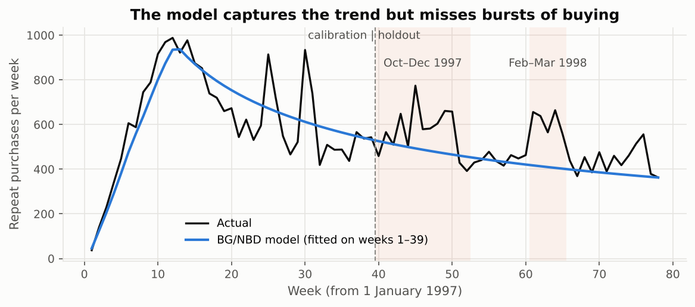
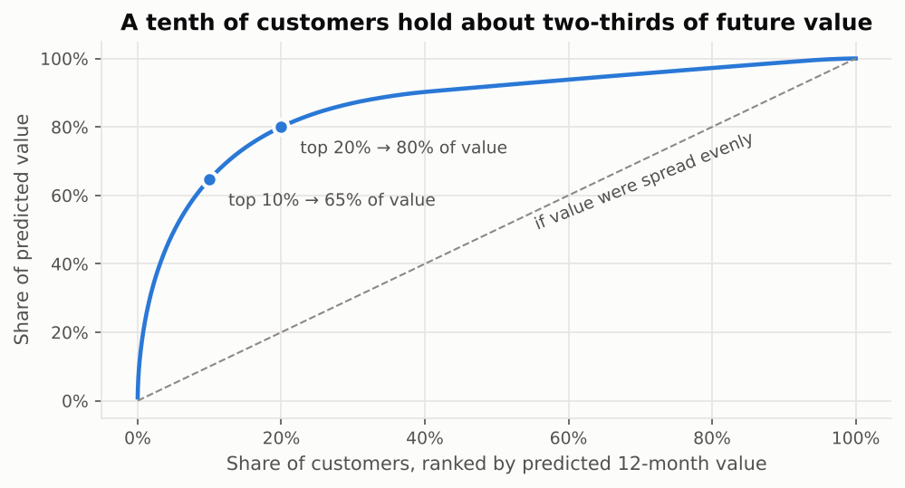

# Product Experimentation and Customer Value Analytics

Two end-to-end analyses of the questions product data scientists answer every week:

1. **Did a product change work?** A rigorous A/B test analysis of a retention experiment with 90,189 users.
2. **Which customers are worth keeping?** Cohort retention and customer lifetime value (CLV) modelling on
   23,570 customers, validated on data the models never saw.

Metrics are defined in **SQL** (DuckDB) and the analysis is in **Python**. The statistical models are
implemented from the original papers and checked against reference results by an automated test suite.

---

## Headline results

| Question | Answer |
|---|---|
| Did moving the first gate from level 30 to 40 change day-7 retention? | **Yes, it lowered it by 0.82 pp** (19.02% → 18.20%, 95% CI −1.33 to −0.31 pp, p = 0.0016; 4.3% relative drop). Bootstrap and Bayesian analyses give the same answer, and it survives Holm correction. **Recommendation: keep the gate at 30.** |
| Is the experiment trustworthy? | It had 80% power to detect changes of ≥0.74 pp. A slight sample-ratio imbalance (50.44% vs 50%, p = 0.0086) is stress-tested: in the worst case the drop shrinks to 0.50 pp (p = 0.056), but the estimate stays negative and any gain above 0.01 pp is ruled out at 95% confidence. The decision holds; the size of the effect needs confirming. |
| How much does peeking at results hurt? | In 2,000 simulated A/A tests, checking 20 times raised the false positive rate from **5% to 24%**. |
| Can we forecast what each customer will do next? | On a 39-week holdout, the BG/NBD model had the lowest error (RMSE 1.73, against 2.16 for a naive repeat-rate forecast and 2.47 for "nobody returns") and a total 14% below actual, against 47% above for the naive forecast. The repeat rate ranks customers slightly better; the model's edge is far more realistic forecast levels and an estimate of whether each customer is still active. |
| Where is future value concentrated? | **The top 10% of customers hold ~65% of predicted 12-month value.** 1,128 historically high-value customers are now more likely gone than active, a natural group for a re-engagement test. |

---

## 1. A/B test: [`notebooks/01_ab_test_gate_placement.ipynb`](notebooks/01_ab_test_gate_placement.ipynb)

**Data:** Cookie Cats mobile game experiment. Players were randomly assigned on install to the first progress
gate at level 30 (control) or level 40 (treatment).

**Analysis plan:** primary metric day-7 retention, secondary day-1 retention, guardrail engagement
(game rounds), with checks for sample ratio, power, multiple comparisons and peeking.

| Step | Method |
|---|---|
| Metric definitions | SQL in DuckDB ([`sql/experiment_metrics.sql`](sql/experiment_metrics.sql)) |
| Data quality | Outlier detection (one account with 49,854 rounds); robust engagement metrics |
| Randomisation check | Sample ratio mismatch chi-square test, plus a worst-case sensitivity analysis |
| Power | Minimum detectable effect and required sample size |
| Effect estimation | Two-proportion z-test, Wald and log-ratio confidence intervals |
| Robustness | Bootstrap intervals and a Beta-Binomial Bayesian model (P(better), expected loss) |
| Guardrail | Mann-Whitney U and capped-mean bootstrap for skewed engagement data |
| Multiple testing | Holm-Bonferroni correction |
| Peeking | Monte Carlo simulation of 2,000 A/A tests |




## 2. Retention and lifetime value: [`notebooks/02_retention_and_lifetime_value.ipynb`](notebooks/02_retention_and_lifetime_value.ipynb)

**Data:** CDNOW transaction log, 69,659 purchases by 23,570 customers (Jan 1997 to Jun 1998), the standard
public benchmark for customer-base models.

| Step | Method |
|---|---|
| Cohort retention | SQL in DuckDB ([`sql/cohort_retention.sql`](sql/cohort_retention.sql)) |
| Purchase forecasting | BG/NBD model (Fader, Hardie and Lee, 2005), implemented with SciPy |
| Spend per purchase | Gamma-Gamma model (Fader, Hardie and Lee, 2005) |
| Validation | Fit on weeks 1–39, test on weeks 40–78, compared with two baselines (naive repeat rate; nobody returns) |
| Assumption check | Independence of spend and purchase frequency (Gamma-Gamma) |
| Business output | 12-month discounted CLV, value concentration, high-value customers at risk |






The model's misses are documented rather than hidden. It assumes steady purchase rates, so it under-forecasts
bursts of buying: October–December 1997 and late February–March 1998 account for about 70% of the holdout
shortfall. With one year of data these cannot be confirmed as seasonal, so the next step would be time-varying
covariates (seasonality, marketing activity) validated on more history.

---

## Verified implementation

`pytest` runs 25 tests, including checks that:

* the z-test, both confidence intervals, the sample-ratio test and the Holm correction match
  **statsmodels / SciPy** exactly, and the sample-size formula matches a hand calculation;
* the BG/NBD fit reproduces the **published parameters** for the CDNOW sample (r = 0.243, α = 4.414,
  a = 0.793, b = 2.426, log-likelihood −9,582.4) and the paper's worked conditional-expectation example (1.226);
* the Gamma-Gamma fit reproduces the published parameters (p = 6.25, q = 3.74, γ = 15.44);
* every prediction (probability alive, expected purchases, expected spend, discounted CLV) matches the
  open-source [`lifetimes`](https://github.com/CamDavidsonPilon/lifetimes) package to within 0.001%;
* the recency/frequency summary matches the reference CDNOW summary customer by customer;
* fixed-horizon testing keeps the false positive rate at ~5%, while peeking does not.

[`scripts/mutation_check.py`](scripts/mutation_check.py) introduces 17 deliberate errors into the formulas one
at a time; the test suite catches every one.

## Repository layout

```
├── data/raw/                 public datasets (see Data sources)
├── notebooks/                the two analyses, executed with outputs
├── reports/figures/          charts used in this README
├── scripts/mutation_check.py checks that the tests catch deliberate errors
├── sql/                      metric definitions run with DuckDB
├── src/prodanalytics/
│   ├── experiment.py         SRM, z-test, power, bootstrap, Bayesian, Holm
│   ├── peeking.py            A/A simulation of repeated significance testing
│   ├── clv.py                RFM summary, BG/NBD, Gamma-Gamma, CLV
│   ├── data.py               loaders
│   └── plotting.py           shared chart style
└── tests/                    pytest suite
```

## Run it

Developed on Python 3.13 with the pinned versions in `requirements.txt`; GitHub Actions re-runs the tests,
the mutation check and both notebooks on every push.

```bash
python -m venv .venv && source .venv/bin/activate
pip install -r requirements.txt
python -m pytest
python -m jupyter nbconvert --to notebook --execute --inplace notebooks/*.ipynb
```

`sql/cohort_retention.sql` reads `data/processed/cdnow_transactions.csv`, which notebook 2 creates from the raw
file (via `prodanalytics.data.load_cdnow_transactions()`). Run the notebook, or that function, before running
the query on its own.

## Data sources

* **Cookie Cats A/B test:** originally released for DataCamp's "Mobile Games A/B Testing with Cookie Cats"
  project (game by Tactile Entertainment). The copy here was taken from a public GitHub mirror.
* **CDNOW:** made available by Peter Fader and Bruce Hardie for research use, and distributed with the
  open-source [`lifetimes`](https://github.com/CamDavidsonPilon/lifetimes) package, from which these files
  were taken.

References:
Fader, P., Hardie, B. and Lee, K. (2005). "Counting your customers the easy way: an alternative to the
Pareto/NBD model." *Marketing Science* 24(2).
Fader, P., Hardie, B. and Lee, K. (2005). "RFM and CLV: using iso-value curves for customer base analysis."
*Journal of Marketing Research* 42(4).

Code is released under the MIT licence; the datasets remain the property of their original owners.
